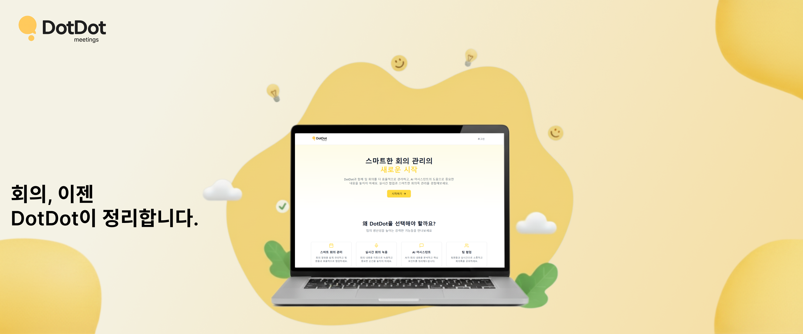
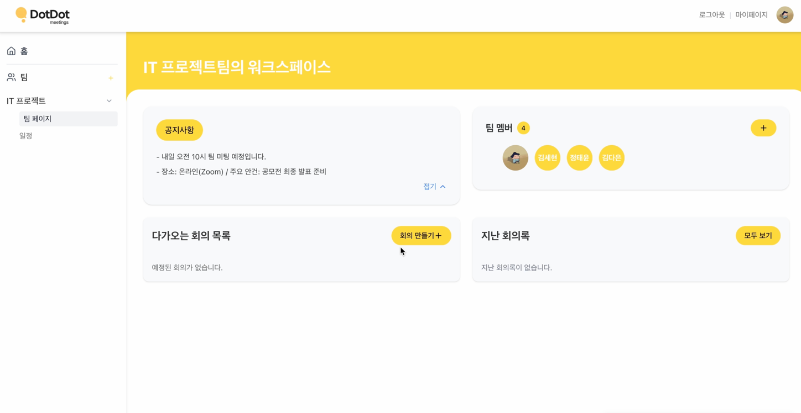
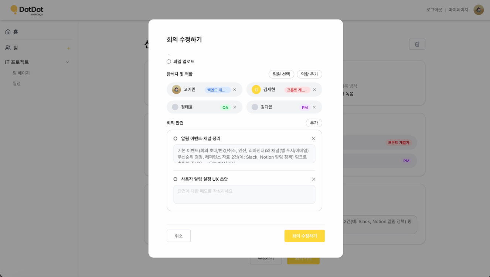
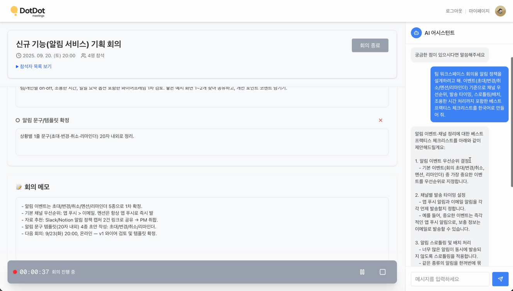
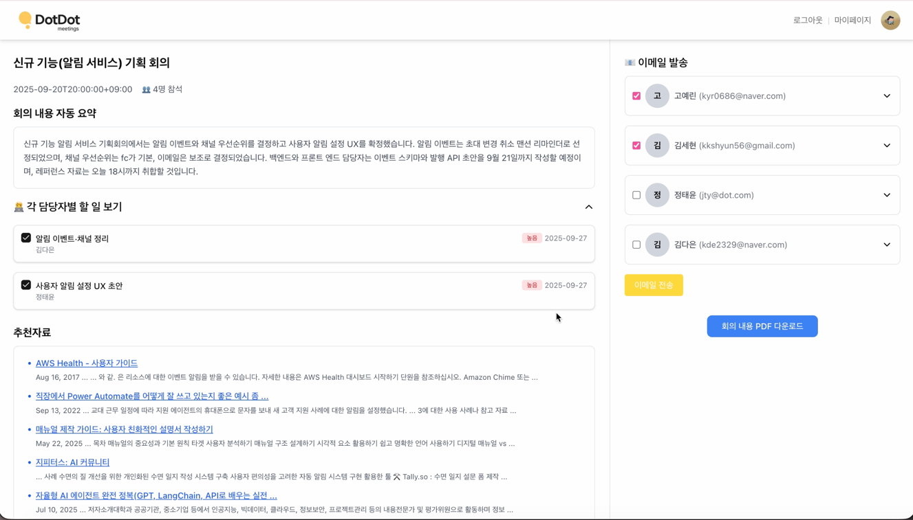
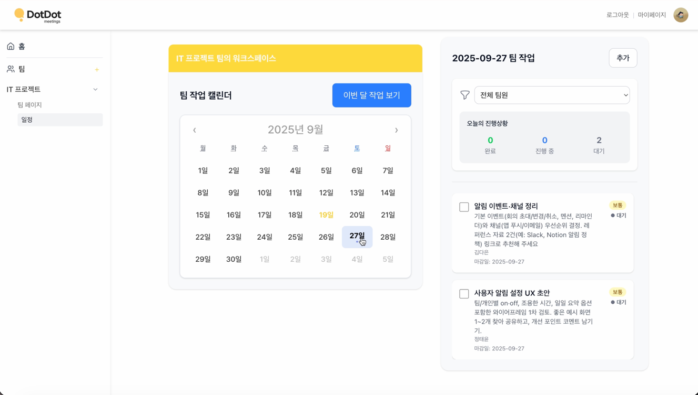

# DotDot_FE

**DotDot**은 회의의 기록–정리–공유 전 과정을 자동화해, 팀이 회의의 본질인 소통과 의사결정에만 집중할 수 있도록 돕는 **AI 회의 어시스턴트 플랫폼**입니다.
본 저장소는 DotDot의 **웹 프론트엔드**로, 회의 녹음부터 요약·태스크 확인, 팀 워크스페이스 관리까지의 전 과정을 사용자에게 제공합니다.

- **회의 녹음/진행 UI**로 안건 등록부터 실시간 회의 진행까지 지원
- 회의 결과(**요약·태스크·추천 자료**)를 한 화면에서 확인
- 안건 기반 **챗봇**과의 실시간 질의응답 인터페이스
- **팀 워크스페이스**에서 회의록·팀원·일정을 통합 관리
- **캘린더 연동 태스크 관리**로 담당자별 진행 상황 트래킹
- 회의 결과 **PDF 저장**, **이메일 공유**, **북마크**를 통한 빠른 재탐색

> **개발 기간**: 2025.07.19 ~ 2025.10.28
> **배포 링크**: [dotdot.it.kr](https://dotdot.it.kr/)
> **Backend Repository**: [DotDot5/DotDot_BE](https://github.com/DotDot5/DotDot_BE)

</br>

<p align="center">
  
</p>

</br>

## 🧑‍💻👩‍💻 팀원 소개

|  |  |  |  |
| :---: | :---: | :---: | :---: |
| **고예린** | **김다은** | **김세현** | **정태윤** |
| [@nenini](https://github.com/nenini) | [@daeun088](https://github.com/daeun088) | [@kkshyun](https://github.com/kkshyun) | [@turden1](https://github.com/turden1) |

</br>

## ⚙️ 주요 기능

### 1. 인증 & 사용자 관리
- **JWT 기반 로그인/회원가입**: Access/Refresh 토큰을 이용한 인증 및 만료 시 자동 재발급(Axios 인터셉터)
- **비밀번호 재설정**: 이메일 링크를 통한 비밀번호 찾기·재설정 플로우
- **마이페이지**: 프로필 이미지 변경, 비밀번호 변경, 이용약관/개인정보처리방침 확인, 회원 탈퇴

### 2. 회의 워크플로우
- **회의 생성**: 안건(Agenda) 등록 및 참여자 초대
- **회의 진행**: 실시간 녹음/일시정지, 녹음 없이 안건·메모만으로 회의를 진행하는 흐름도 지원
- **회의 결과**: STT 스크립트, AI 요약, 담당자별 태스크, 참고 자료 추천을 결과 페이지에서 한 번에 확인
- **다시 듣기 & 북마크**: 녹음 오디오 재생 및 중요 구간 북마크로 회의 복기
- **접근 제어**: 종료된 회의·권한 없는 팀에 대한 URL 직접 접근을 가드 처리 후 전용 안내 페이지로 이동

### 3. AI 챗봇 & 자료 추천
- **맥락형 챗봇**: 회의 안건·요약·대화 히스토리를 기반으로 회의 중 즉시 질의응답
- **추천 자료 섹션**: 회의 주제와 연관된 참고 자료를 결과 화면에서 바로 탐색

### 4. 팀 워크스페이스
- **팀 생성/관리**: 팀 생성, 이름 변경, 멤버 초대 및 권한 관리
- **팀 회의 기록**: 팀 단위 회의록 목록 및 상세 기록 조회
- **캘린더 연동 태스크 관리**: 월별 캘린더에서 태스크 조회·필터링, 상태(TODO/DONE 등) 관리

### 5. 결과 공유
- **PDF 저장**: 회의 요약/태스크/리포트를 PDF로 내보내기 (`jspdf`, `@react-pdf/renderer`)
- **이메일 발송**: 회의 결과를 참여자에게 이메일로 공유

</br>

## 📷 주요 화면

<table>
<tr>
<td width="50%" valign="top">

**1. 팀 워크스페이스 생성**
팀을 만들고 멤버를 초대해, 팀 단위로 회의와 산출물을 한 곳에서 관리합니다.



</td>
<td width="50%" valign="top">

**2. 회의 생성 & 안건(Agenda) 등록**
회의 시작 전 안건을 등록해, 요약과 태스크 정리의 기준점을 고정합니다.



</td>
</tr>
<tr>
<td width="50%" valign="top">

**3. 회의 진행: 녹음 & AI 어시스턴트**
회의 음성을 녹음해 기록하고, 진행 중에도 안건·메모를 기반으로 AI 어시스턴트에게 바로 질의응답할 수 있습니다.



</td>
<td width="50%" valign="top">

**4. AI 자동 정리 & 공유**
회의 종료 후 핵심 요약과 담당자별 태스크, 관련 참고자료를 자동으로 정리하고, PDF 저장·이메일 발송으로 바로 공유합니다.



</td>
</tr>
<tr>
<td colspan="2" valign="top">

**5. 후속 관리: 캘린더 & 태스크 트래킹**
팀 캘린더에서 담당자별 작업을 확인하고 진행 상황을 관리합니다.



</td>
</tr>
</table>

</br>

## 🛠 기술 스택

### Frontend
<p>


</p>

### 상태 관리 & 통신
<p>


</p>

### 미디어 & 문서
<p>


</p>

### Infra & Tooling
<p>


</p>

### Collaboration & Project Management
<p>


</p>

</br>

## 📂 프로젝트 구조

```plaintext
src
├── api/                     # 백엔드 API 호출 함수 (auth, meeting, team, user, bookmark ...)
├── app/                     # Next.js App Router 페이지
│   ├── api/                 #   서버 라우트 핸들러 (STT/오디오 프록시, 이메일 발송 등)
│   ├── auth/                #   로그인/회원가입/비밀번호 재설정
│   ├── calendar/[id]/       #   팀 캘린더 & 태스크 관리
│   ├── dashboard/           #   대시보드
│   ├── meeting/[id]/        #   회의 진행/결과/다시보기
│   ├── mypage/              #   마이페이지
│   └── team/[id]/           #   팀 워크스페이스 & 회의 기록
├── components/              # 화면 단위 컴포넌트 (meeting, layout, ui, internal ...)
├── context/                 # 전역 Context (활성 팀 등)
├── hooks/                   # 커스텀 훅 (useTasks, useMeeting, useBookmark ...)
├── lib/                     # Axios 인스턴스, React Query 클라이언트, 공통 유틸
├── services/                # 도메인별 API 서비스 레이어 (taskApi, teamApi ...)
├── types/                   # 공통 타입 정의
└── utils/                   # 포맷터 등 유틸 함수
```

</br>

## 🚀 시작하기

```bash
# 의존성 설치
npm install

# 개발 서버 실행 (Turbopack)
npm run dev
```

[http://localhost:3000](http://localhost:3000) 에서 확인할 수 있습니다.

### 환경 변수

루트에 `.env.local` 파일을 생성하고 아래 값을 채워주세요.

```env
NEXT_PUBLIC_API_BASE_URL=

GOOGLE_CLOUD_STORAGE_BUCKET=
GOOGLE_APPLICATION_CREDENTIALS=

EMAIL_USER=
EMAIL_PASSWORD=
```

> Vercel 등 서버리스 배포 환경에서는 `GOOGLE_APPLICATION_CREDENTIALS` 대신 서비스 계정 JSON을 문자열로 담은
> `GOOGLE_APPLICATION_CREDENTIALS_JSON`을 사용합니다. 자세한 내용은 [트러블슈팅 문서](docs/TROUBLESHOOTING.md#2-vercel-배포-환경에서-google-cloud-인증-실패)를 참고하세요.

</br>

## 🌐 Deployment

- **Hosting**: Vercel
- **Backend 연동**: `NEXT_PUBLIC_API_BASE_URL` 환경 변수를 통해 Spring Boot 백엔드([DotDot_BE](https://github.com/DotDot5/DotDot_BE))와 통신
- **Build**: `next build` — 배포 우선순위에 따라 `next.config.ts`에서 ESLint/TypeScript 빌드 차단을 완화하고, 별도 CI에서 타입 검사를 수행

</br>

## 📑 Trouble Shooting

프론트엔드 개발 중 겪은 문제와 해결 과정은 [`docs/TROUBLESHOOTING.md`](docs/TROUBLESHOOTING.md)에 상세히 정리되어 있습니다. 그중 대표 사례는 다음과 같습니다.

#### 1) Vercel 배포 환경에서 Google Cloud 인증 실패
- **문제 (Problem)**: 로컬에서는 정상 동작하는 STT 기능이 Vercel 배포 환경에서 Google Cloud 클라이언트 초기화에 실패
- **원인 분석 (Analysis)**: 로컬은 서비스 계정 키 **파일 경로**를 참조하는데, 서버리스 배포 환경에는 파일을 올릴 수 없어 인증 정보를 읽지 못함
- **해결 방법 (Solution)**: 환경변수를 검사해 배포 환경에서는 `GOOGLE_APPLICATION_CREDENTIALS_JSON`(JSON 문자열)을 파싱한 `credentials`를, 로컬은 `keyFilename`을 사용하도록 분기하는 헬퍼 추가
- **결과 (Result)**: 로컬/배포 환경 모두 동일한 코드로 Google Cloud 인증 성공

---

#### 2) Axios 인터셉터 토큰 재발급(reissue) 무한 루프
- **문제 (Problem)**: accessToken 만료 시 자동 재발급 로직에서, 재발급 요청 자체가 401을 받으면 재요청을 반복할 위험 존재
- **원인 분석 (Analysis)**: 응답 인터셉터가 `401 + 특정 에러코드`이면 요청 종류를 구분하지 않고 무조건 reissue를 트리거
- **해결 방법 (Solution)**: 요청 인터셉터에서 reissue 요청에는 만료 토큰을 붙이지 않고, 응답 인터셉터에서도 실패한 요청이 reissue 요청이면 재시도하지 않도록 가드 추가
- **결과 (Result)**: 토큰 재발급 실패 시에도 무한 루프 없이 로그인 페이지로 안전하게 이동

---

#### 3) 종료된(FINISHED) 회의 URL 직접 접근
- **문제 (Problem)**: 이미 종료된 회의의 상세 페이지 URL을 직접 입력하면 진행 중 회의처럼 편집 UI가 노출됨
- **원인 분석 (Analysis)**: 상세 페이지가 회의 상태를 검증하지 않고 무조건 편집 화면을 렌더링, UI 숨김만으로는 직접 접근을 막을 수 없음
- **해결 방법 (Solution)**: 페이지 진입 시 완료 회의 목록/상태를 조회하는 가드를 두어, 종료된 회의는 전용 접근 차단 페이지(`/meeting/forbidden`)로 리다이렉트
- **결과 (Result)**: URL 직접 접근 시나리오에서도 회의 상태에 맞는 화면만 노출

> 더 많은 사례(Next.js 라우트 핸들러 타입 에러, 태스크 데이터 흐름 리팩토링, 백엔드 URL 관리 등)는 [트러블슈팅 문서](docs/TROUBLESHOOTING.md)에서 확인하실 수 있습니다.
